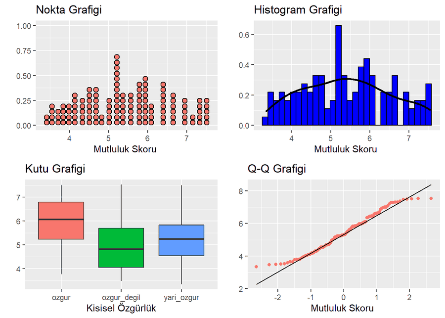
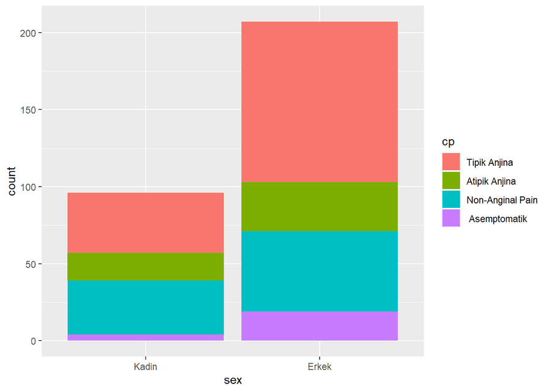
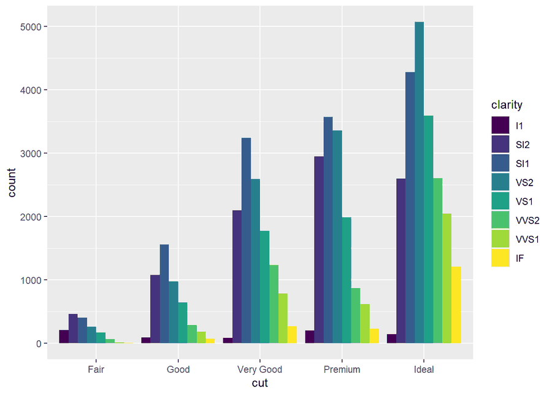
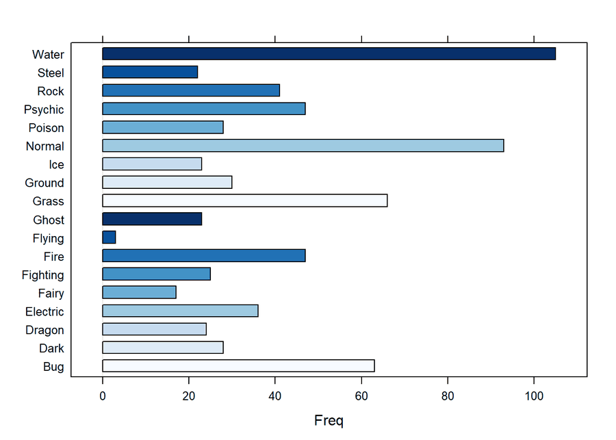
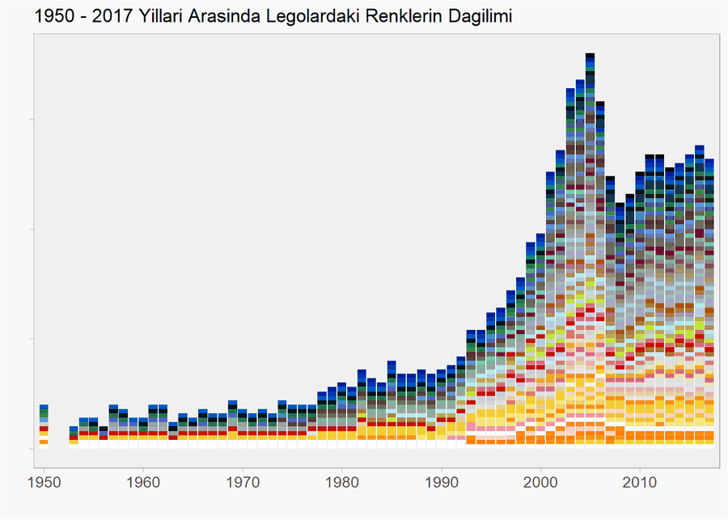

# R Markdown ile Veri Analizi Çalışmaları

Farklı veri setleri üzerinde R ile yapılmış veri düzenleme, tanımlayıcı istatistik, görselleştirme
ve modelleme çalışmaları. Her klasörde R Markdown kaynak dosyası (`.Rmd`), derlenmiş rapor (`.html`)
ve kullanılan veri bulunur.

Raporları okumak için ilgili `.html` dosyasını indirip tarayıcıda aç.

## Çalışmalar

| Klasör | Konu | Yöntemler |
|---|---|---|
| [`Ulke-Mutluluk-Siralamasi`](Ulke-Mutluluk-Siralamasi) | 2017 Dünya Mutluluk Raporu verisiyle ülkelerin mutluluk skorları | Konum, yayılım ve ilişki ölçüleri, normallik, tek yönlü ANOVA, çoklu doğrusal regresyon |
| [`Makine-Ogrenmesi`](Makine-Ogrenmesi) | Carseats ve World Happiness Report 2021 verileriyle makine öğrenmesi | Regresyon, lojistik regresyon, SVM, karar ağaçları, rastgele orman, K-means, hiyerarşik kümeleme, PCA |
| [`Pokemon`](Pokemon) | 721 Pokémon'un özellikleri | Eksik gözlem, normallik testi, regresyon, varyans homojenliği, ANOVA |
| [`Heart`](Heart) | Kalp hastalığı verisi (303 hasta) | Tanımlayıcı istatistikler, normallik testi, `dplyr` işlemleri, `ggplot2` grafikleri |
| [`Diamond`](Diamond) | 53.940 elmasın fiyat ve özellikleri | Tanımlayıcı istatistikler, `dplyr` işlemleri, `ggplot2` grafikleri |
| [`Lego`](Lego) | Lego setleri, parçaları ve renkleri | Tabloların birleştirilmesi, `dplyr` işlemleri, yıllara göre renk dağılımı |

Makine öğrenmesi çalışmasının güncel sürümü ayrı bir repoda:
[Machine-Learning](https://github.com/ozgurnrttn/Machine-Learning).

## Örnek çıktılar

| Mutluluk skoru | Kalp verisi |
|---|---|
|  |  |

| Elmas | Pokémon | Lego |
|---|---|---|
|  |  |  |

## Çalıştırma

Her rapor kendi klasöründen derlenir; dosya yolları o klasöre göredir.

```r
rmarkdown::render("Heart/Heart.Rmd")
```

Kullanılan başlıca paketler: `tidyverse`, `rstatix`, `pastecs`, `plotly`, `car`, `GGally`, `lmtest`,
`Amelia`. Her raporun tam paket listesi kendi `.Rmd` dosyasının başındadır.

Not: `Makine-Ogrenmesi/ML.Rmd` içindeki dünya haritası bölümü `gdp.csv` dosyasını okur; bu dosya
[Machine-Learning](https://github.com/ozgurnrttn/Machine-Learning) reposundadır.

## Veri

- Mutluluk: [World Happiness Report 2017](https://worldhappiness.report/ed/2017/),
  [Kaggle](https://www.kaggle.com/adwaywadekar/social-progress-and-happiness)
- Kalp: [Heart Disease UCI](https://www.kaggle.com/ronitf/heart-disease-uci)
- Elmas: `ggplot2::diamonds` ([Kaggle](https://www.kaggle.com/shivam2503/diamonds))
- Pokémon: [alopez247/pokemon](https://www.kaggle.com/alopez247/pokemon)
- Lego: [rtatman/lego-database](https://www.kaggle.com/rtatman/lego-database)
